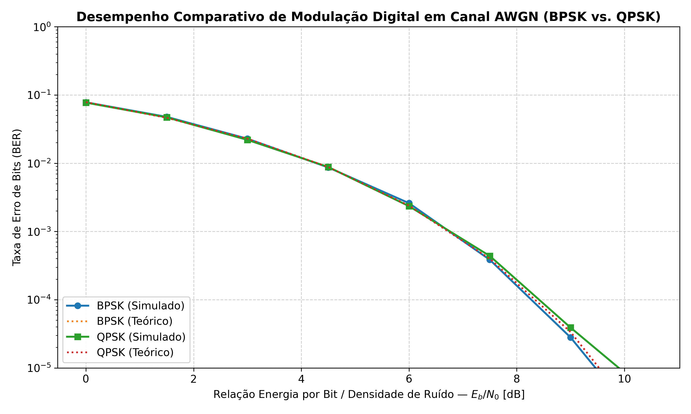
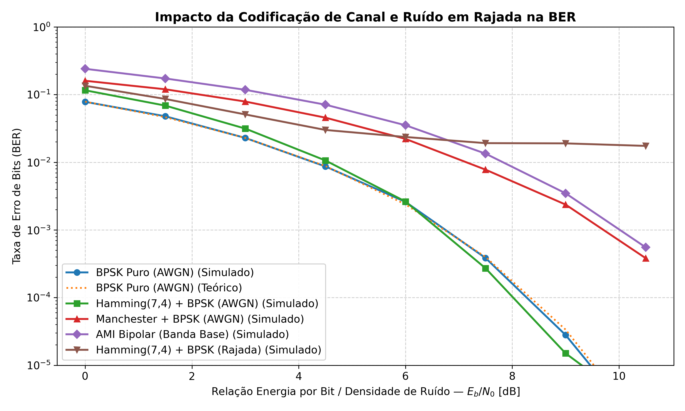
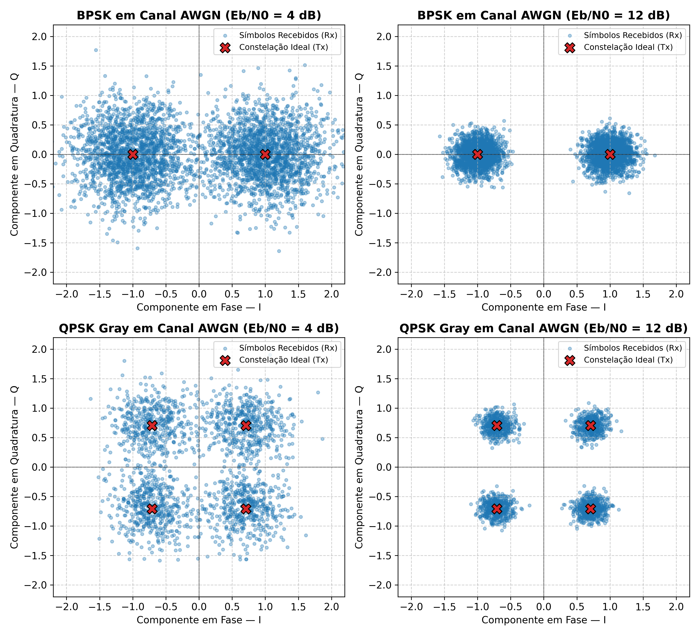
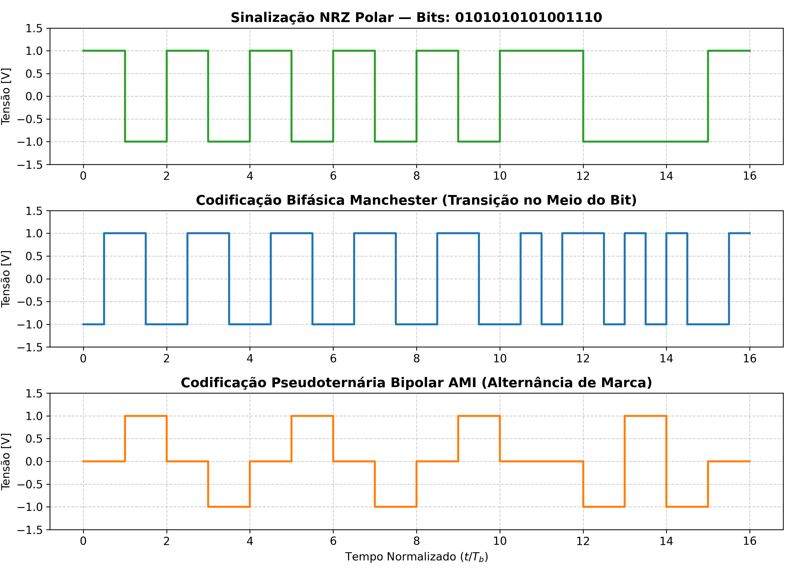

# Relatório Técnico: Simulador de Codificação de Canal e Modulação Digital

**Disciplina:** Redes de Computadores II

---

## 1. Introdução e Fundamentação Teórica

Este projeto implementa um simulador completo de camada física e subcamada de controle de enlace lógico em Python, projetado para avaliar quantitativamente o impacto da codificação de canal, da codificação de linha e da modulação digital sobre a Taxa de Erro de Bits (BER) e a eficiência espectral de enlaces de comunicação.

A arquitetura do software espelha o **Modelo de Referência de Comunicação de Dados**:

$$\text{Fonte ASCII} \xrightarrow{\text{bits}} \text{Codificador de Canal} \xrightarrow{\text{bits/níveis}} \text{Modulador} \xrightarrow{\text{símbolos (baud)}} \text{Canal Ruidoso } (\Sigma) \xrightarrow{\text{Rx}} \text{Demodulador} \xrightarrow{} \text{Decodificador} \xrightarrow{} \text{Destino}$$

O desempenho dos esquemas simulados é confrontado com dois limites fundamentais da Teoria da Informação:

1. **Teorema de Nyquist (Canal Ideal sem Ruído):** Estabelece a capacidade máxima de sinalização em função da largura de banda $B$ (Hz) e do número de estados discretos $N = 2^k$ da constelação, onde $k$ é a quantidade de bits transportados por símbolo (_baud_):
   $$C_{\text{Nyquist}} = 2B \log_2(N) = 2B \cdot k \quad [\text{bit/s}]$$
2. **Teorema de Shannon-Hartley (Canal com Ruído AWGN):** Define o limite superior assintótico de transmissão livre de erros na presença de ruído térmico com potência $N$ e potência de sinal $S$:
   $$C_{\text{Shannon}} = B \log_2\left(1 + \frac{S}{N}\right) \quad [\text{bit/s}]$$

---

## 2. Arquitetura do Projeto e Responsabilidade dos Arquivos

O sistema foi estruturado sob o paradigma de **Programação Orientada a Objetos (POO)** com tipagem estática explícita (`typing` e `numpy.typing`) e aplicação do padrão de projeto **Strategy**. Esse desacoplamento permite combinar diferentes codificadores e moduladores em tempo de execução sem alterar a lógica do transmissor, do receptor ou do canal.

```text
channel-coding-modulation/
├── run_simulation.py                # Script principal (CLI) que orquestra todos os experimentos
├── requirements.txt                 # Dependências científicas (numpy, scipy, matplotlib)
├── outputs/                         # Artefatos gerados automaticamente pela simulação
│   ├── 01_ber_vs_snr_modulations.png
│   ├── 02_ber_vs_snr_coding_impact.png
│   ├── 03_iq_constellations.png
│   ├── 04_baseband_waveforms.png
│   └── simulation_log.txt
├── src/
│   ├── core/                        # Núcleo de dados, entidades Tx/Rx e meios físicos
│   │   ├── structures.py            # Aliases matemáticos (BitArray, IQSignal) e dataclasses
│   │   ├── source.py                # Conversão bidirecional ASCII <-> Fluxo Binário
│   │   ├── channel.py               # Modelos de canal AWGN e Ruído Impulsivo em Rajada
│   │   ├── transmitter.py           # Orquestrador da cadeia de transmissão
│   │   └── receiver.py              # Orquestrador da cadeia de recepção
│   ├── coding/                      # Codificadores de linha e corretores de erro (FEC)
│   │   ├── base.py                  # Classe abstrata BaseChannelCodec (contrato encode/decode)
│   │   ├── manchester.py            # Codificação bifásica Manchester (IEEE 802.3)
│   │   ├── ami.py                   # Codificação pseudoternária Bipolar AMI
│   │   └── hamming.py               # Código de bloco sistemático Hamming (7,4)
│   ├── modulation/                  # Moduladores digitais em banda passante
│   │   ├── base.py                  # Classe abstrata BaseModulator (contrato I/Q e BER teórica)
│   │   ├── bpsk.py                  # Modulador/Demodulador BPSK antipodal
│   │   └── qpsk.py                  # Modulador/Demodulador QPSK com codificação Gray
│   ├── simulation/                  # Motor estatístico e métricas de capacidade
│   │   ├── engine.py                # Simulador Monte Carlo adaptativo e teste ASCII
│   │   └── metrics.py               # Cálculo de eficiência espectral e limite de Shannon
│   └── visualization/               # Camada de visualização analítica
│       └── plots.py                 # Geração de gráficos BER, constelações I/Q e ondas no tempo
└── tests/                           # Suíte de verificação de integridade
    ├── test_codec_modulators.py     # Testes unitários em canal ideal (BER = 0)
    └── test_channel_tx_rx.py        # Testes de integração Tx-Canal-Rx e calibração AWGN
```

### Detalhamento por Módulo e Arquivo

| Camada / Diretório       | Arquivo             | Responsabilidade Técnica                                                                                                                                                                                                                                               |
| :----------------------- | :------------------ | :--------------------------------------------------------------------------------------------------------------------------------------------------------------------------------------------------------------------------------------------------------------------- |
| **Raiz**                 | `run_simulation.py` | Ponto de entrada da aplicação. Instancia os cenários de teste, dispara a transmissão ASCII, executa a varredura Monte Carlo em múltiplas SNRs, calcula a eficiência espectral, salva os gráficos em `outputs/` e grava o log completo em `outputs/simulation_log.txt`. |
| **`src/core/`**          | `structures.py`     | Define os tipos base `BitArray` (`np.ndarray` de `uint8` em $\{0, 1\}$), `IQSignal` (`np.ndarray` complexo `complex128` no plano Fase/Quadratura) e a dataclass `SimulationMetrics` para cálculo de BER empírica e teórica.                                            |
| **`src/core/`**          | `source.py`         | Implementa a classe `DataStream`. Converte strings ASCII em vetores binários de 8 bits por caractere (`text_to_bits`) e reconstrói o texto no destino (`bits_to_text`), validando o alinhamento de octetos.                                                            |
| **`src/core/`**          | `channel.py`        | Implementa a hierarquia `BaseChannel` $\to$ `AWGNChannel` $\to$ `ImpulsiveBurstChannel`. Injeta ruído branco gaussiano calibrado por $E_b/N_0$ e rajadas impulsivas de alta amplitude que corrompem símbolos contíguos.                                                |
| **`src/core/`**          | `transmitter.py`    | Implementa a classe `Transmitter`. Encadeia codificação de canal e modulação, calcula a taxa efetiva de código ($R_c$), aplica _padding_ de alinhamento para moduladores multi-bit e gerencia o roteamento entre banda base e banda passante.                          |
| **`src/core/`**          | `receiver.py`       | Implementa a classe `Receiver`. Executa o pipeline inverso: demodulação coerente I/Q (ou decisão por limiar de tensão em banda base), remoção de _padding_ e decodificação de canal/linha.                                                                             |
| **`src/coding/`**        | `base.py`           | Define a interface abstrata `BaseChannelCodec`, impondo as assinaturas `encode(bits)` e `decode(symbols)` a todos os esquemas de codificação.                                                                                                                          |
| **`src/coding/`**        | `manchester.py`     | Implementa `ManchesterCodec` (padrão IEEE 802.3): mapeia `0` $\to$ `[0, 1]` e `1` $\to$ `[1, 0]`, garantindo transição no meio de cada período de bit $T_b$ para recuperação de relógio (_clocking_) e eliminação de nível DC ($R_c = 0{,}5$).                         |
| **`src/coding/`**        | `ami.py`            | Implementa `AMICodec` (_Alternate Mark Inversion_): codifica `0` como $0\text{ V}$ e alterna pulsos $+1\text{ V}$ e $-1\text{ V}$ para bits `1` consecutivos, eliminando a componente contínua sem expandir a taxa de símbolos ($R_c = 1{,}0$).                        |
| **`src/coding/`**        | `hamming.py`        | Implementa `Hamming74Codec`: código FEC sistemático $(n=7, k=4, R_c=4/7)$ que posiciona bits de paridade nas potências de 2 ($P_1, P_2, P_4$) e dados em ($D_1, D_2, D_3, D_4$), corrigindo autonomamente 1 erro de bit por palavra-código via cálculo de síndrome.    |
| **`src/modulation/`**    | `base.py`           | Define a interface abstrata `BaseModulator`, especificando `bits_per_symbol`, `spectral_efficiency`, `modulate()`, `demodulate()` e `theoretical_ber()`.                                                                                                               |
| **`src/modulation/`**    | `bpsk.py`           | Implementa `BPSKModulator` ($M=2$, $1\text{ bit/símbolo}$): mapeia `0` $\to +1 + 0j$ e `1` $\to -1 + 0j$. Demodula no eixo real e fornece a BER teórica $P_b = \frac{1}{2}\text{erfc}(\sqrt{E_b/N_0})$.                                                                |
| **`src/modulation/`**    | `qpsk.py`           | Implementa `QPSKModulator` ($M=4$, $2\text{ bits/símbolo}$): mapeia dibits nos quatro quadrantes com codificação Gray e energia unitária normalizada ($E_s = 1$, amplitudes $\pm 1/\sqrt{2}$ nos eixos $I$ e $Q$).                                                     |
| **`src/simulation/`**    | `engine.py`         | Implementa `MonteCarloSimulator`. Executa simulações de mensagens ASCII completas e varreduras estatísticas adaptativas de BER $\times$ $E_b/N_0$ até atingir convergência estatística.                                                                                |
| **`src/simulation/`**    | `metrics.py`        | Implementa `PerformanceAnalyzer`. Calcula eficiência espectral nominal e efetiva ($\eta_{\text{eff}} = R_c \cdot \log_2 M$), taxa útil em Mbps e o limite mínimo de $E_b/N_0$ de Shannon.                                                                              |
| **`src/visualization/`** | `plots.py`          | Implementa `SimulationPlotter`. Gera e exporta em 300 DPI os quatro conjuntos gráficos de análise da camada física e de enlace.                                                                                                                                        |

---

## 3. Pipeline de Execução da Simulação

A simulação opera em duas frentes complementares dentro de `run_simulation.py`:

### 3.1 Fluxo Ponta a Ponta (Transmissor $\to$ Canal $\to$ Receptor)

1. **Geração da Fonte (`DataStream.text_to_bits`):** Uma cadeia de caracteres ASCII é convertida em um vetor unidimensional de bits ($8\text{ bits/byte}$, ordem MSB para LSB).
2. **Codificação (`Transmitter.transmit`):**
   - Se houver um `codec` configurado, o vetor binário recebe redundância temporal (`Hamming74Codec` expande cada 4 bits em 7) ou sinalização de linha (`ManchesterCodec` dobra a cadência; `AMICodec` gera níveis ternários $\{-1, 0, +1\}$).
   - Calcula-se a taxa efetiva $R_c = \frac{N_{\text{bits\_info}}}{N_{\text{símbolos\_codificados}}}$.
3. **Modulação ou Banda Base (`Transmitter.transmit`):**
   - **Modo Banda Passante (`modulator != None`):** Caso o comprimento codificado não seja múltiplo de $k = \log_2 M$ (ex.: dibits do QPSK), anexa-se _padding_ temporário. O modulador projeta os bits no plano complexo I/Q. O `Transmitter` bloqueia explicitamente o acoplamento direto entre `AMICodec` e moduladores binários, pois símbolos pseudoternários pertencem à transmissão em banda base.
   - **Modo Banda Base (`modulator == None`):** Sinais AMI são convertidos diretamente em níveis reais $\{-1{,}0, 0{,}0, +1{,}0\}\text{ V}$; fluxos binários puros utilizam sinalização NRZ Polar ($\pm 1{,}0\text{ V}$).
4. **Calibração e Propagação no Canal (`AWGNChannel.transmit`):**
   - Para garantir comparação energética justa entre esquemas com diferentes taxas de código $R_c$ e ordens de modulação $k$, a densidade espectral de ruído $N_0$ é ajustada a partir da energia média empírica por símbolo $E_s$:
     $$N_0 = \frac{E_s}{k \cdot R_c \cdot 10^{(E_b/N_0)_{\text{dB}} / 10}}$$
   - Adicionam-se componentes gaussianas independentes $n_I, n_Q \sim \mathcal{N}(0, N_0/2)$ em fase e quadratura. No `ImpulsiveBurstChannel`, sobrepõem-se ainda rajadas de ruído impulsivo de alta variância ($\sigma_{\text{imp}} = 4{,}5$) afetando 6 símbolos consecutivos com probabilidade $p = 0{,}008$.
5. **Demodulação e Decodificação (`Receiver.receive`):**
   - O receptor aplica detecção coerente por mínima distância euclidiana (limiar em $0\text{ V}$ nos eixos $I$ e $Q$ para BPSK/QPSK; limiares em $-0{,}5\text{ V}$ e $+0{,}5\text{ V}$ para os três níveis do AMI), descarta o _padding_ de modulação e invoca `codec.decode()` para corrigir erros (via síndrome de Hamming) ou extrair os dados de linha.

### 3.2 Varredura Estatística Monte Carlo (`MonteCarloSimulator.run_ber_curve`)

Para cada ponto de $E_b/N_0 \in \{0{,}0;\ 1{,}5;\ 3{,}0;\ 4{,}5;\ 6{,}0;\ 7{,}5;\ 9{,}0;\ 10{,}5\}\text{ dB}$, o simulador transmite lotes sucessivos de $50.000\text{ bits}$ pseudoaleatórios. O laço de amostragem encerra adaptativamente quando acumula **pelo menos $150\text{ erros de bit}$** (assegurando estabilidade estatística na estimativa da média) ou quando atinge o teto computacional de **$1.000.000\text{ bits}$** transmitidos.

---

## 4. Passo a Passo para Instalação e Reprodução

### Requisitos de Ambiente

- Python 3.10 ou superior
- Bibliotecas: `numpy>=1.24.0`, `matplotlib>=3.7.0`, `scipy>=1.10.0`

### Procedimento de Execução

1. **Clonar o repositório e entrar no diretório raiz:**

   ```bash
   git clone <URL_DO_REPOSITORIO>
   cd channel-coding-modulation
   ```

2. **Criar e ativar o ambiente virtual Python:**

   ```bash
   python3 -m venv .venv
   source .venv/bin/activate        # macOS / Linux
   # .venv\Scripts\activate         # Windows
   ```

3. **Instalar as dependências:**

   ```bash
   pip install -r requirements.txt
   ```

4. **Executar os testes unitários e de integração (validação em canal ideal e calibração):**

   ```bash
   python3 -m tests.test_codec_modulators
   python3 -m tests.test_channel_tx_rx
   ```

5. **Executar a simulação completa e gerar os artefatos:**
   ```bash
   python3 run_simulation.py
   ```
   Ao término da execução, todos os gráficos estarão disponíveis em `outputs/*.png` e o relatório numérico completo em `outputs/simulation_log.txt`.

---

## 5. Resultados Experimentais, Gráficos e Análise Crítica

### 5.1 Transmissão Ponta a Ponta de Mensagem ASCII

Transmitiu-se a mensagem `"UNISINOS 2026 - Redes de Computadores II: Camada Fisica e Enlace"` ($64\text{ bytes} = 512\text{ bits}$) sob três regimes de relação sinal-ruído ($E_b/N_0$):

| Regime ($E_b/N_0$) | Esquema de Transmissão   | Erros de Bit | BER Empírica  | Trecho da Mensagem Recuperada (`Rx`)              |
| :----------------: | :----------------------- | :----------: | :-----------: | :------------------------------------------------ |
|     **3,0 dB**     | BPSK Não Codificado      |   16 / 512   |   `0.03125`   | `'UNISILS 2026!- rude3 dm CompTta\$ores II: ...'` |
|     **3,0 dB**     | QPSK Não Codificado      |   11 / 512   |   `0.02148`   | `'UNISINOS 2026 - Redes dä Com`utadraó II: ...'`  |
|     **3,0 dB**     | Hamming(7,4) + QPSK      |   10 / 512   |   `0.01953`   | `'UNISINOS 2026 - Redes&de ComðtAdores AI: ...'`  |
|     **3,0 dB**     | AMI Bipolar (Banda Base) |   52 / 512   |   `0.10156`   | `'UNYSMÞÏ*rð27`-`Ru`e{ de omputadgveq ÉK\* ...'`  |
|     **7,0 dB**     | BPSK Não Codificado      |   1 / 512    |   `0.00195`   | `'UNISINOS 2026 - Redes de Computadores II: ...'` |
|     **7,0 dB**     | QPSK Não Codificado      |   0 / 512    |   `0.00000`   | `'UNISINOS 2026 - Redes de Computadores II: ...'` |
|     **7,0 dB**     | **Hamming(7,4) + QPSK**  | **0 / 512**  | **`0.00000`** | `'UNISINOS 2026 - Redes de Computadores II: ...'` |
|     **7,0 dB**     | AMI Bipolar (Banda Base) |   5 / 512    |   `0.00977`   | `'UNÉSINOR 2 26 - Rmdes de Computadores II: ...'` |
|    **11,0 dB**     | **Todos os Esquemas**    | **0 / 512**  | **`0.00000`** | `'UNISINOS 2026 - Redes de Computadores II: ...'` |

**Interpretação:** Como a codificação ASCII utiliza 8 bits por caractere sem redundância intrínseca, a inversão de um único bit desloca o código numérico para outro símbolo imprimível ou estendido (ex.: `'o'` $\to$ `'ä'`). Em $3{,}0\text{ dB}$, o ruído térmico supera frequentemente a margem de decisão. O esquema `Hamming(7,4) + QPSK` já zera os erros em $7{,}0\text{ dB}$, enquanto o AMI Bipolar exige maior $E_b/N_0$ ($11{,}0\text{ dB}$) devido à menor distância entre seus três níveis de tensão ($\{-1, 0, +1\}\text{ V}$).

---

### 5.2 Comparação entre Modulações Digitais: BPSK vs. QPSK



Os valores empíricos levantados via Monte Carlo demonstram aderência estrita às curvas analíticas $P_b = \frac{1}{2}\text{erfc}(\sqrt{E_b/N_0})$:

| $E_b/N_0$ [dB] | BER BPSK (Simulada) | BER QPSK (Simulada) |
| :------------: | :-----------------: | :-----------------: |
|    **0,0**     |     `0.078240`      |     `0.077340`      |
|    **1,5**     |     `0.047860`      |     `0.047060`      |
|    **3,0**     |     `0.022880`      |     `0.022000`      |
|    **4,5**     |     `0.008680`      |     `0.008820`      |
|    **6,0**     |     `0.002600`      |     `0.002350`      |
|    **7,5**     |     `0.000385`      |     `0.000438`      |
|    **9,0**     |     `0.000028`      |     `0.000039`      |
|    **10,5**    |     `0.000001`      |     `0.000004`      |

**Análise Técnica:** Embora a distância euclidiana mínima entre símbolos adjacentes na constelação QPSK normalizada ($d_{\min} = \sqrt{2} \approx 1{,}414$) seja menor que no BPSK ($d_{\min} = 2{,}0$) para uma mesma energia de símbolo $E_s$, cada símbolo QPSK transporta $2\text{ bits}$ ($E_s = 2E_b$). Como as portadoras em Fase ($I$) e Quadratura ($Q$) são ortogonais e utilizam **mapeamento Gray** — onde quadrantes vizinhos diferem em apenas 1 bit —, um erro de símbolo próximo ao limiar corrompe apenas 1 dos 2 bits. Consequentemente, o QPSK alcança **exatamente a mesma BER por bit do BPSK**, mas dobrando a taxa de transmissão na mesma largura de banda.

---

### 5.3 Impacto da Codificação de Canal e Ruído em Rajada



| $E_b/N_0$ [dB] | BPSK Puro (AWGN) | Hamming(7,4) + BPSK | Hamming(7,4) + QPSK | Manchester + BPSK | AMI Bipolar (Banda Base) | Hamming(7,4) + BPSK (Rajada) |
| :------------: | :--------------: | :-----------------: | :-----------------: | :----------------: | :----------------------: | :--------------------------: |
|    **0,0**     |    `0.078240`    |     `0.115880`      |     `0.119660`      |     `0.160120`     |        `0.234720`        |          `0.133900`          |
|    **1,5**     |    `0.047860`    |     `0.068820`      |     `0.068500`      |     `0.119900`     |        `0.176760`        |          `0.089640`          |
|    **3,0**     |    `0.022880`    |     `0.031460`      |     `0.033920`      |     `0.078960`     |        `0.121160`        |          `0.050020`          |
|    **4,5**     |    `0.008680`    |     `0.010640`      |     `0.010380`      |     `0.045660`     |        `0.070240`        |          `0.030940`          |
|    **6,0**     |    `0.002600`    |     `0.002630`      |     `0.002530`      |     `0.022160`     |        `0.033620`        |          `0.022720`          |
|    **7,5**     |    `0.000385`    |     `0.000272`      |     `0.000310`      |     `0.007780`     |        `0.013120`        |          `0.018960`          |
|    **9,0**     |    `0.000028`    |     `0.000015`      |     `0.000010`      |     `0.002370`     |        `0.003360`        |          `0.018780`          |
|    **10,5**    |    `0.000001`    |     `0.000002`      |     `0.000002`      |     `0.000382`     |        `0.000608`        |          `0.018160`          |

**Análise Técnica:**

1. **Ponto de Cruzamento (_Coding Gain_) do Hamming(7,4):** Em SNRs baixas ($0{,}0$ a $4{,}5\text{ dB}$), o código Hamming(7,4) apresenta BER pior que o BPSK não codificado (`0.115880` vs. `0.078240` em $0\text{ dB}$). Como cada 4 bits de informação dividem energia com 3 bits de paridade ($R_c = 4/7$), a energia por bit transmitido cai em $10\log_{10}(4/7) \approx -2{,}43\text{ dB}$, gerando frequentemente **2 ou mais erros dentro do mesmo bloco de 7 bits** — o que excede a capacidade corretora de $t = 1\text{ erro}$ do código e leva a decodificações incorretas. A partir de $\approx 6{,}2\text{ dB}$, ocorre o cruzamento: em $7{,}5\text{ dB}$, a BER reduz-se de `0.000385` para `0.000272`, e em $9{,}0\text{ dB}$ cai quase pela metade (`0.000015` contra `0.000028`). _(Nota: em $10{,}5\text{ dB}$, os valores na ordem de $10^{-6}$ refletem a resolução finita da janela de $10^6$ bits)._
2. **Colapso sob Ruído em Rajada (_Error Floor_):** No canal impulsivo, a BER do `Hamming(7,4) + BPSK` estagna em um patamar próximo a $1{,}8 \times 10^{-2}$ mesmo em SNRs elevadas. Rajadas de 6 símbolos consecutivos corrompem múltiplos bits adjacentes da mesma palavra-código. Isso comprova empiricamente que códigos de bloco simples exigem **entrelaçamento (_interleaving_)** para dispersar erros contíguos no tempo entre diversas palavras-código distintas.
3. **Penalidade Energética do AMI Bipolar:** Por distribuir três níveis de tensão ($\{-1, 0, +1\}\text{ V}$) com metade da distância de decisão ($0{,}5\text{ V}$ contra $1{,}0\text{ V}$ do antipodal), o AMI sofre uma penalidade de $\approx 3{,}5\text{ dB}$ em relação ao BPSK puro.
4. **Codificação Manchester em Camada Física vs. Camada de Enlace:** Com $R_c = 0{,}5$, o Manchester dobra a taxa de sinais em relação ao fluxo de informação e apresenta penalidade energética em toda a faixa simulada: a BER passa de `0.078240` no BPSK puro para `0.160120` em $0{,}0\text{ dB}$ e de `0.022880` para `0.078960` em $3{,}0\text{ dB}$. O efeito diminui em SNR altas, mas permanece relevante: `0.007780` em $7{,}5\text{ dB}$, `0.002370` em $9{,}0\text{ dB}$ e `0.000382` em $10{,}5\text{ dB}`. Se a validação seguir estritamente as regras de transição físicas do IEEE 802.3, violações como `[0,0]` ou `[1,1]` podem ser tratadas como descarto de quadro.

---

### 5.4 Constelações I/Q no Plano Complexo



A projeção cartesiana das amostras recebidas ($r = s + n_I + jn_Q$) ilustra geometricamente a margem de ruído:

- **Em $E_b/N_0 = 4{,}0\text{ dB}$ (Painéis Esquerdos):** O desvio padrão do ruído ($\sigma \approx 0{,}447$ por dimensão no BPSK e $\sigma \approx 0{,}316$ no QPSK) faz com que as nuvens de pontos ultrapassem os limiares de decisão ($I = 0$ e $Q = 0$), provocando erros de demodulação.
- **Em $E_b/N_0 = 12{,}0\text{ dB}$ (Painéis Direitos):** A variância do ruído reduz-se em $8\text{ dB}$ (fator de $6{,}3\times$ em potência), confinando os símbolos estritamente em torno das coordenadas ideais ($\{\pm 1 + 0j\}$ no BPSK e $\{\pm 0{,}707 \pm 0{,}707j\}$ no QPSK) com probabilidade de cruzamento de eixo desprezível ($< 10^{-8}$).

---

### 5.5 Formas de Onda em Banda Base no Domínio do Tempo



A visualização temporal dos primeiros 16 bits da mensagem (`0101010101001110`) evidencia o compromisso físico entre sincronismo e componente contínua (DC):

- **NRZ Polar:** Mantém tensão constante durante sequências repetidas de `0`s ou `1`s. Pela análise de Fourier, isso gera uma componente DC não nula ($a_0/2 \neq 0$) e dificulta a recuperação de relógio no receptor.
- **Manchester (IEEE 802.3):** Garante uma transição de polaridade no centro de todo intervalo $T_b$ (alto $\to$ baixo para `1`, baixo $\to$ alto para `0`), tornando o sinal auto-sincronizante e com média DC nula, ao custo de dobrar a frequência fundamental de chaveamento.
- **Bipolar AMI:** Codifica zeros como $0\text{ V}$ e alterna $+1\text{ V}$ e $-1\text{ V}$ para marcas (`1`), anulando a componente DC sem dobrar a taxa de símbolos, mas permanecendo vulnerável a longas sequências de `0`s.

---

### 5.6 Eficiência Espectral e Limite de Shannon ($B = 1\text{ MHz}$)

A tabela abaixo consolida o balanço entre taxa de transmissão líquida e proximidade ao limite teórico de Shannon ($E_b/N_0 = (2^{\eta_{\text{eff}}} - 1)/\eta_{\text{eff}}$) para um canal de banda passante $B = 1\text{ MHz}$:

| Esquema de Comunicação         | Bits/Símbolo ($k$) | Taxa de Código ($R_c$) | Ef. Nominal [bps/Hz] | Ef. Efetiva ($\eta_{\text{eff}}$) [bps/Hz] | Taxa Útil ($B=1\text{ MHz}$) | Limite de Shannon ($E_b/N_0$ mín.) |
| :----------------------------- | :----------------: | :--------------------: | :------------------: | :----------------------------------------: | :--------------------------: | :--------------------------------: |
| **BPSK Não Codificado**        |         1          |         1,000          |         1,00         |                   1,000                    |          1,000 Mbps          |              0,00 dB               |
| **QPSK Não Codificado (Gray)** |         2          |         1,000          |         2,00         |                   2,000                    |          2,000 Mbps          |              1,76 dB               |
| **Hamming(7,4) + BPSK**        |         1          |         0,571          |         1,00         |                   0,571                    |          0,571 Mbps          |              -0,70 dB              |
| **Hamming(7,4) + QPSK**        |         2          |         0,571          |         2,00         |                   1,143                    |          1,143 Mbps          |              0,24 dB               |
| **Manchester + BPSK**          |         1          |         0,500          |         1,00         |                   0,500                    |          0,500 Mbps          |              -0,82 dB              |
| **AMI Bipolar (Banda Base)**   |         1          |         1,000          |         1,00         |                   1,000                    |          1,000 Mbps          |              0,00 dB               |

---

## 6. Síntese de Engenharia

Os resultados obtidos comprovam os três compromissos centrais no projeto de sistemas digitais de comunicação:

1. **Eficiência Espectral vs. Potência:** Elevar a ordem da modulação de BPSK ($M=2$) para QPSK ($M=4$) dobra a capacidade útil de $1{,}0\text{ Mbps}$ para $2{,}0\text{ Mbps}$ em $1\text{ MHz}$ de banda sem degradação da BER por bit, desde que se utilize codificação Gray e sincronismo coerente de fase.
2. **Confiabilidade (FEC) vs. Largura de Banda:** O código `Hamming(7,4)` reduz a eficiência espectral efetiva em $42{,}9\%$ ($R_c = 4/7$), mas proporciona ganho de codificação líquido para $E_b/N_0 > 6{,}2\text{ dB}$. Ao acoplar `Hamming(7,4) + QPSK`, obtém-se uma arquitetura equilibrada que entrega **$1{,}143\text{ Mbps}$** ($14{,}3\%$ acima do BPSK puro) com correção autônoma de erros simples.
3. **Adequação ao Perfil de Ruído do Meio:** Códigos de bloco lineares isolados são eficazes contra ruído branco térmico (AWGN), mas falham diante de interferências impulsivas em rajada — cenário que demanda a adição de entrelaçamento (_interleaving_) ou códigos cíclicos de rajada (como Reed-Solomon) nas camadas de enlace e física.
